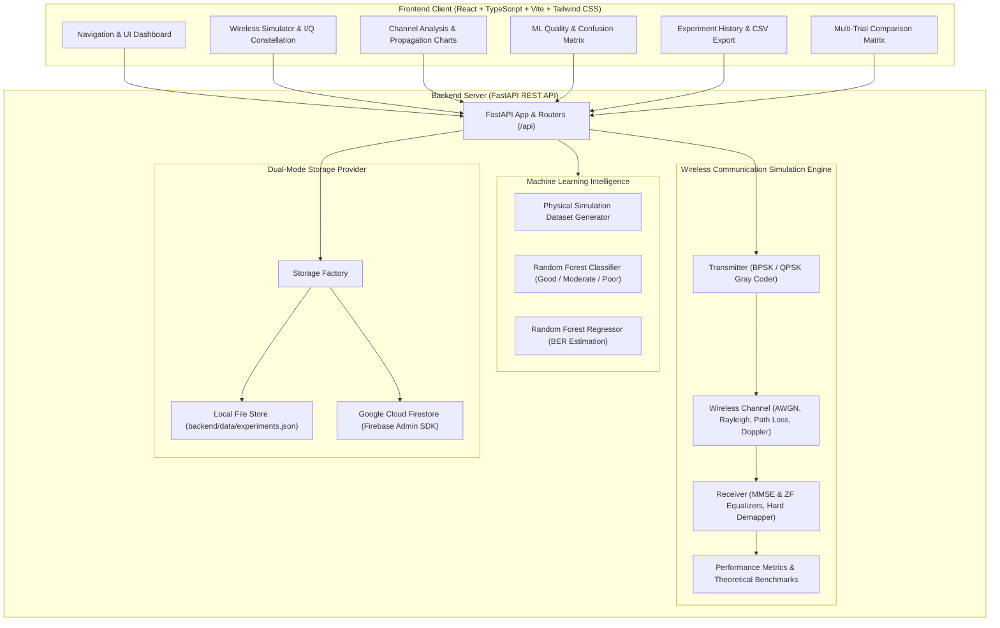
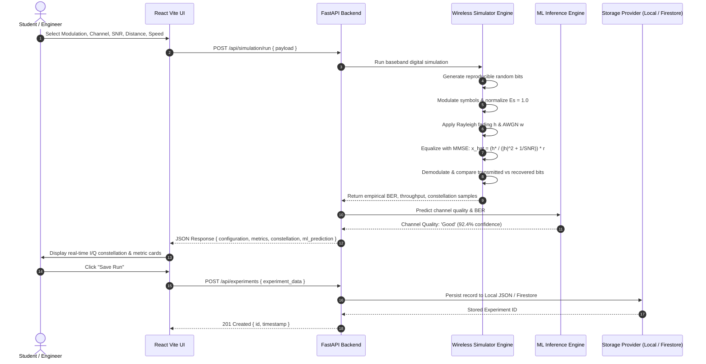

# Design and Performance Analysis of Wireless Channels Under Fading and Mobility Using Machine Learning and Cloud Computing

[](https://www.python.org/)
[](https://fastapi.tiangolo.com/)
[](https://react.dev/)
[](https://www.typescriptlang.org/)
[](https://tailwindcss.com/)
[](LICENSE)

An academic engineering B.Tech Computer Science project integrating:
1. **Wireless Mobile Communication (WMC)** &mdash; Primary baseband simulation module
2. **Machine Learning (ML)** &mdash; Intelligent channel quality assessment and BER regression
3. **Cloud Computing** &mdash; Persistent experiment storage with Google Cloud Firestore and offline fallback

---

## 1. Project Abstract

Mobile communication reliability is subject to dynamic wireless channel impairments, including Additive White Gaussian Noise (AWGN), multipath Rayleigh flat-fading, distance-dependent path loss, and receiver mobility-induced Doppler shift. This project presents a full-stack, mathematically rigorous simulation platform that models baseband digital transmission (BPSK and QPSK), simulates channel distortions, implements Zero-Forcing (ZF) and Minimum Mean Square Error (MMSE) receiver equalizers, computes empirical Bit Error Rate (BER) and throughput, and compares them with exact analytical theoretical benchmarks.

A supervised Machine Learning subsystem (Random Forest Classifier and Regressor) is trained on 1,000 physical simulation trials to perform real-time channel quality classification (Good, Moderate, Poor) and numerical BER regression. Experiment history is persisted via Google Cloud Firestore or thread-safe local JSON storage for seamless, zero-cost offline laboratory execution.

---

## 2. Problem Statement

In modern cellular (4G LTE / 5G NR) and wireless local area networks (Wi-Fi 6/7), performance fluctuates dramatically with received signal strength, environmental clutter, distance from the base station, and receiver velocity. High mobility introduces Doppler frequency spread ($f_D = v f_c / c$), shortening channel coherence time and degrading detection. 

Traditional university education often separates theoretical wireless equations from interactive software implementation. Existing simulators are either proprietary (e.g., MATLAB Communications Toolbox) or disjointed scripts without interactive graphical interfaces, persistent cloud storage, or machine learning capabilities. This project bridges that gap by delivering an open-source, full-stack, interactive engineering platform.

---

## 3. Main Objectives

- **Baseband Digital Transmitter:** Generate pseudo-random binary sequences, map bits to complex symbols using BPSK (1 bit/sym) and Gray-coded QPSK (2 bits/sym) under strict symbol energy normalization ($E_s = 1.0$).
- **Realistic Channel Propagation:** Mathematically simulate AWGN ($w \sim \mathcal{CN}(0, N_0)$), complex Rayleigh flat-fading ($h \sim \mathcal{CN}(0, 1)$), log-distance path loss ($PL(d) = PL(d_0) + 10 n \log_{10}(d/d_0)$), and receiver mobility ($f_D$).
- **Receiver Equalization & Detection:** Implement Zero-Forcing and MMSE equalizers to mitigate fading distortion, decode bits, compute empirical BER, and evaluate theoretical benchmarks.
- **Machine Learning Channel Assessment:** Train Random Forest models on simulated data to classify channel link state (Good, Moderate, Poor) and estimate BER.
- **Dual-Mode Cloud Architecture:** Provide zero-configuration offline local file persistence with seamless cloud synchronization to Google Cloud Firestore when credentials are configured.
- **Interactive Engineering Dashboard:** Provide real-time I/Q constellation diagrams, logarithmic BER vs. SNR curves, path loss charts, Doppler shift plots, and side-by-side experiment comparisons.

---

## 4. Existing Approach vs. Proposed Approach

| Feature | Existing Academic Approach | Proposed WirelessSim Platform |
| :--- | :--- | :--- |
| **Execution Environment** | Static MATLAB scripts / CLI scripts | Modern Full-Stack Web Application (FastAPI + React Vite) |
| **Channel Models** | Often purely theoretical or AWGN only | AWGN + Complex Rayleigh Fading + Log-Distance Path Loss + Doppler Spread |
| **Equalization** | Usually omitted or assumes noiseless CSI | Zero-Forcing & MMSE Equalizers with explicit noise-enhancement modeling |
| **Intelligence** | None | Random Forest multi-class quality classifier & BER regressor |
| **Persistence** | Volatile in-memory variables | Dual-mode: Local JSON document store + Google Cloud Firestore |
| **Visualization** | Static MATLAB figures | Interactive SVG/Canvas charts (Recharts) with logarithmic scaling & tooltips |
| **Reproducibility** | Variable random states | Configurable random seeds for exact scientific repeatability |

---

## 5. System Architecture



---

## 6. Data Flow Diagram



---

## 7. Hardware and Software Requirements

### Hardware Requirements
- **Processor:** 64-bit Intel Core i3 / AMD Ryzen 3 or higher
- **RAM:** Minimum 4 GB (8 GB recommended for dataset synthesis)
- **Disk Space:** 500 MB free storage
- **Operating System:** Windows 10/11, macOS 12+, or Ubuntu Linux 20.04+

### Software Requirements
- **Python:** Version 3.10, 3.11, 3.12, 3.13, or 3.14
- **Node.js:** Version 18.x, 20.x, 22.x, or 25.x
- **Package Managers:** `pip` (Python) and `npm` (Node.js)

---

## 8. Installation Instructions

### Step 1: Clone or Navigate to Project
```powershell
cd "d:\new project"
```

### Step 2: Backend Dependencies Setup
Ensure Python is installed and install the required dependencies:
```powershell
pip install -r backend/requirements.txt
```

### Step 3: Frontend Dependencies Setup
Navigate to the `frontend` directory and install npm packages:
```powershell
cd frontend
npm install
cd ..
```

---

## 9. Local Execution Instructions

### A. Start the Backend API Server
Run the FastAPI development server from the root project directory:
```powershell
$env:PYTHONPATH="backend"
python -m uvicorn app.main:app --host 127.0.0.1 --port 8000 --reload
```
- API Server is live at: `http://127.0.0.1:8000`
- Interactive Swagger API Documentation: `http://127.0.0.1:8000/docs`
- Alternative ReDoc Documentation: `http://127.0.0.1:8000/redoc`

### B. Start the Frontend Application
In a separate terminal, launch the Vite development server:
```powershell
cd frontend
npm run dev
```
- Open your browser to: `http://localhost:5173`

---

## 10. API Endpoint Documentation

| Method | Endpoint | Description | Request Body | Response |
| :--- | :--- | :--- | :--- | :--- |
| `GET` | `/` | System root discovery & health | None | `{ project, version, status, docs }` |
| `GET` | `/api/simulation/config-options` | Supported modulations, channels & defaults | None | `{ modulations, channels, equalizers, defaults }` |
| `POST` | `/api/simulation/run` | Execute point wireless simulation | `SingleSimulationRequest` | `SingleSimulationResponse` (metrics & constellation) |
| `POST` | `/api/simulation/batch` | Execute SNR sweep experiment | `BatchSimulationRequest` | `BatchSimulationResponse` (array of SNR/BER points) |
| `POST` | `/api/ml/predict` | Online ML channel assessment | `MLPredictionRequest` | `MLPredictionResponse` (class, confidence, predicted BER) |
| `GET` | `/api/ml/evaluation` | Held-out test evaluation report | None | `MLEvaluationResponse` (accuracy, confusion matrix, importances) |
| `POST` | `/api/experiments` | Persist experiment record | `ExperimentCreateRequest` | `ExperimentResponse` (ID, timestamp, full payload) |
| `GET` | `/api/experiments` | Retrieve experiment history | Query: `limit, modulation, channel` | `List[ExperimentResponse]` |
| `GET` | `/api/experiments/{id}` | Fetch single experiment details | Path: `id` | `ExperimentResponse` |
| `DELETE` | `/api/experiments/{id}` | Delete experiment record | Path: `id` | `{ status: "success" }` |
| `POST` | `/api/experiments/compare` | Compare multiple experiments | `{ experiment_ids: [...] }` | Comparative summary matrix |
| `GET` | `/api/experiments/export/csv` | Download CSV spreadsheet of history | None | `text/csv` attachment stream |
| `GET` | `/api/system/status` | Runtime, storage mode, ML health | None | `SystemStatus` |

---

## 11. Wireless Mathematical Models

### 1. Digital Modulation and Normalization
- **BPSK:** Binary bit sequence $b \in \{0, 1\}$ maps to $s = (1 - 2b) + 0j$. Symbol energy $E_s = |s|^2 = 1.0$.
- **QPSK:** Bit pairs $(b_0, b_1)$ are mapped using Gray coding:
  $$s = \frac{(1 - 2b_0) + j(1 - 2b_1)}{\sqrt{2}}$$
  Average symbol energy $E_s = 1.0$, bit energy $E_b = E_s / 2 = 0.5$.

### 2. Complex AWGN Noise Scaling
Given nominal SNR in dB, linear SNR is $\text{SNR} = 10^{\text{SNR}_{\text{dB}}/10}$. For average symbol power $P_s = 1$, noise power $N_0 = 1 / \text{SNR}$. Complex noise $w = w_I + j w_Q$ has standard deviation per dimension:
$$\sigma = \sqrt{\frac{N_0}{2}} = \sqrt{\frac{1}{2 \cdot \text{SNR}}}$$

### 3. Multipath Rayleigh Flat-Fading
The complex channel coefficient $h = h_I + j h_Q$ satisfies $h_I, h_Q \sim \mathcal{N}(0, 0.5)$, ensuring $\mathbb{E}[|h|^2] = 1.0$.
When receiver velocity $v > 0$, temporal correlation across symbols follows the Clarke-Jakes model:
$$\rho = J_0(2\pi f_D T_s)$$
where $J_0(\cdot)$ is the Bessel function of the first kind of order 0, $T_s$ is symbol duration, and $f_D$ is maximum Doppler shift. Channel evolution is modeled via Gauss-Markov autoregression:
$$h[k] = \rho \cdot h[k-1] + \sqrt{1 - \rho^2} \cdot w_h[k]$$

### 4. Log-Distance Path Loss
Path loss at distance $d$ relative to reference distance $d_0$:
$$PL(d)[\text{dB}] = PL(d_0) + 10 \cdot n \cdot \log_{10}\left(\frac{d}{d_0}\right)$$
Effective received SNR experienced by the receiver detector:
$$\text{SNR}_{\text{eff}}[\text{dB}] = \text{SNR}_{\text{nominal}}[\text{dB}] - 10 \cdot n \cdot \log_{10}\left(\frac{\max(d, 1)}{d_0}\right)$$

### 5. Receiver Equalizers
- **Zero-Forcing (ZF):** $\hat{x}_{\text{ZF}} = \frac{y}{h} = \frac{h^*}{|h|^2} y$. Causes noise enhancement during deep fades ($|h| \to 0$).
- **MMSE Detector:** 
  $$\hat{x}_{\text{MMSE}} = \frac{h^*}{|h|^2 + \frac{1}{\text{SNR}_{\text{eff}}}} y$$
  Optimally balances inverted channel distortion against noise variance to maximize output SINR.

### 6. Theoretical Bit Error Rate (BER) Benchmarks
- **BPSK in AWGN:** $P_b = Q\left(\sqrt{2\frac{E_b}{N_0}}\right) = \frac{1}{2} \text{erfc}\left(\sqrt{\text{SNR}}\right)$
- **QPSK in AWGN:** $P_b = \frac{1}{2} \text{erfc}\left(\sqrt{\frac{\text{SNR}}{2}}\right)$
- **Rayleigh Flat-Fading with Perfect CSI:**
  $$P_b = \frac{1}{2} \left(1 - \sqrt{\frac{\bar{\gamma}_b}{1 + \bar{\gamma}_b}}\right)$$
  where $\bar{\gamma}_b$ is average received SNR per bit.

### 7. Throughput (Goodput) Estimate
$$\text{Throughput}[\text{kbps}] = \frac{R_{\text{raw}} \cdot (1 - \text{BER})}{1000}$$
where $R_{\text{raw}} = \text{Symbol Rate} \times \text{bits per symbol}$. Frame success rate over packet size $L=1024$ bits is $(1 - \text{BER})^L$.

---

## 12. Machine Learning Training & Evaluation Methodology

### Dataset Synthesis
The dataset is generated directly by invoking the physical baseband simulator (`backend/app/ml/dataset.py`) across a systematic grid of parameters:
- **Sample Size:** 1,000 physical simulation trials
- **Parameters:** SNR (-5 to 30 dB), BPSK/QPSK, AWGN/Rayleigh, Distance (10 to 200 m), Speed (0 to 120 km/h), Path-loss exponent (2.0 to 3.5).
- **Target Variable (Channel Quality):**
  - **Good:** $\text{BER} < 0.001$ (Minimal frame loss, optimal for streaming / VoIP)
  - **Moderate:** $0.001 \le \text{BER} \le 0.05$ (Tolerable link, standard ARQ recovers lost frames)
  - **Poor:** $\text{BER} > 0.05$ (Severe corruption, high retransmissions)
- **Target Variable (Regression):** Empirical numerical BER.

### Model Architecture
- **Algorithm:** Scikit-Learn `RandomForestClassifier` (100 estimators, max depth 12) and `RandomForestRegressor`.
- **Pre-processing:** `StandardScaler` for continuous features (`effective_snr_db`, `distance_m`, `speed_mps`, `path_loss_exponent`, `received_power_dbm`, `doppler_shift_hz`) and one-hot encoding for categorical variables (`modulation`, `channel_type`).
- **Data Splitting:** 75% Training / 25% Testing stratified split to prevent data leakage.

### Held-Out Test Evaluation Results
- **Classification Accuracy:** **87.20%**
- **Weighted F1-Score:** **0.8626**
- **Confusion Matrix:**
  $$\begin{bmatrix} 129 & 4 & 0 \\ 16 & 23 & 6 \\ 4 & 2 & 66 \end{bmatrix}$$
- **Regression MAE:** **0.0182**
- **Regression $R^2$ Score:** **0.8576**

> **Scientific Validation Note:** This machine learning model was trained and evaluated on synthetic data generated from the mathematical physical simulation engine. It demonstrates channel-quality pattern recognition under simulated propagation models and is not claimed to be pre-calibrated for field cellular networks without transfer learning on real drive-test measurement data.

---

## 13. Cloud Configuration & Deployment

### Local Mode (Default)
By default, the application runs in **Local Mode**. Experiment records are saved to `backend/data/experiments.json` with thread-safe file locking. No external cloud credentials, credit cards, or internet access are required.

### Google Cloud Firestore Mode
To enable cloud synchronization across multiple browser sessions and devices:
1. Create a Firebase project in the [Firebase Console](https://console.firebase.google.com/).
2. Enable **Cloud Firestore** in test or production mode.
3. In **Project Settings → Service Accounts**, click **"Generate New Private Key"** and download `serviceAccountKey.json`.
4. Place the key in `backend/credentials/serviceAccountKey.json`.
5. Update your `backend/.env` file:
   ```ini
   STORAGE_MODE=firebase
   FIREBASE_SERVICE_ACCOUNT_PATH=credentials/serviceAccountKey.json
   FIREBASE_PROJECT_ID=your-project-id
   FIRESTORE_COLLECTION=wireless_experiments
   ```
6. Restart the backend service. Experiments will automatically synchronize to Google Cloud Firestore with zero frontend modifications.

---

## 14. Testing Procedure

### Backend Automated Test Suite
Run the full 22-test automated suite verifying wireless mathematical algorithms, ML inference, cloud storage, and FastAPI REST endpoints:
```powershell
$env:PYTHONPATH="backend"
python -m pytest backend/tests/ -v
```

### Frontend Automated Test Suite
Run Vitest and React Testing Library tests verifying UI components, badges, cards, and pages:
```powershell
cd frontend
npm test
```

### Frontend Production Build Verification
Verify TypeScript type-checking and Vite bundling:
```powershell
cd frontend
npm run build
```

---

## 15. Limitations and Assumptions

1. **Flat-Fading Assumption:** The current Rayleigh fading model assumes frequency-flat fading across the signal bandwidth. Frequency-selective fading requiring multipath tapped-delay line equalizers (e.g. Viterbi or OFDM cyclic prefix) is a natural future extension.
2. **Channel State Information (CSI):** The receiver assumes perfect or MMSE-tracked channel state information. Real receivers experience channel estimation error in high-mobility Doppler environments.
3. **No Direct Inter-Cell Interference (ICI):** Metrics reflect SNR rather than SINR because co-channel cellular interferers are not simulated in this baseband model.
4. **Throughput Definition:** Throughput represents goodput calculated as $R_{\text{raw}} \cdot (1 - \text{BER})$ without higher-layer TCP/IP congestion window backoff dynamics.

---

## 16. Future Enhancements

- Support for higher-order QAM modulations (16-QAM, 64-QAM, 256-QAM).
- Implementation of Orthogonal Frequency Division Multiplexing (OFDM) for frequency-selective multipath channels.
- Forward Error Correction (FEC) codes: Convolutional Codes, Turbo Codes, and Low-Density Parity-Check (LDPC) codes.
- Real-time drive-test GPS trajectory ingestion to replay real-world mobile signal conditions.
- Deep Learning Reinforcement Learning (DQN / PPO) for adaptive modulation and coding (AMC) control.

---

## 17. Academic Literature & References

1. **John G. Proakis & Masoud Salehi** (2008). *Digital Communications*, 5th Edition. McGraw-Hill.
2. **Theodore S. Rappaport** (2002). *Wireless Communications: Principles and Practice*, 2nd Edition. Prentice Hall.
3. **Andrea Goldsmith** (2005). *Wireless Communications*. Cambridge University Press.
4. **David Tse & Pramod Viswanath** (2005). *Fundamentals of Wireless Communication*. Cambridge University Press.
5. **Bernard Sklar** (2001). *Digital Communications: Fundamentals and Applications*, 2nd Edition. Prentice Hall.

---

## 18. Project Structure

```text
├── backend/
│   ├── app/
│   │   ├── api/                     # REST API route handlers
│   │   │   ├── routes_simulation.py  # Simulation endpoints
│   │   │   ├── routes_ml.py          # ML prediction & evaluation
│   │   │   ├── routes_experiments.py # CRUD & comparison endpoints
│   │   │   └── routes_system.py      # System diagnostics
│   │   ├── core/
│   │   │   └── config.py             # Pydantic settings & environment
│   │   ├── ml/                       # Machine Learning subsystem
│   │   │   ├── dataset.py            # Physical simulation dataset synthesis
│   │   │   ├── train.py              # Random Forest training pipeline
│   │   │   ├── predict.py            # Online inference service
│   │   │   └── evaluation.py         # Held-out metrics reporting
│   │   ├── schemas/                  # Pydantic request/response models
│   │   ├── storage/                  # Dual-mode persistence
│   │   │   ├── base.py               # Abstract storage interface
│   │   │   ├── local_store.py        # Local thread-safe JSON persistence
│   │   │   └── firebase_store.py     # Google Cloud Firestore provider
│   │   ├── wireless/                 # Core signal processing module
│   │   │   ├── modulation.py         # BPSK / QPSK Gray mapping & energy normalization
│   │   │   ├── transmitter.py        # Pseudo-random bit generator
│   │   │   ├── channels.py           # AWGN, Rayleigh, Path Loss, Doppler
│   │   │   ├── receiver.py           # MMSE & Zero-Forcing equalizers
│   │   │   ├── metrics.py            # BER & throughput calculations
│   │   │   └── simulator.py          # Unified simulation orchestrator
│   │   └── main.py                   # FastAPI application factory
│   ├── data/
│   │   ├── models/                   # Persisted .joblib models & evaluation JSON
│   │   └── experiments.json          # Persistent experiment history
│   ├── tests/                        # 22 automated unit & integration tests
│   ├── train_model.py                # Reproducible ML training script
│   ├── requirements.txt              # Backend dependencies
│   └── .env.example                  # Environment configuration template
│
├── frontend/
│   ├── src/
│   │   ├── charts/                   # Recharts visualization components
│   │   │   ├── BerSnrChart.tsx       # Logarithmic BER vs SNR curve
│   │   │   ├── ConstellationChart.tsx# I/Q scatter diagram
│   │   │   ├── PathLossChart.tsx     # Received power vs distance curve
│   │   │   ├── DopplerChart.tsx      # Doppler shift vs speed curve
│   │   │   └── ConfusionMatrixChart.tsx # Multi-class evaluation heatmap
│   │   ├── components/               # Reusable UI widgets (Navbar, Badge, MetricCard)
│   │   ├── pages/                    # 8 full dashboard views
│   │   │   ├── OverviewPage.tsx      # Executive project overview
│   │   │   ├── SimulatorPage.tsx     # Interactive wireless lab
│   │   │   ├── ChannelAnalysisPage.tsx # In-depth channel comparisons
│   │   │   ├── MLAnalysisPage.tsx    # ML evaluation & online sandbox
│   │   │   ├── HistoryPage.tsx       # Filterable table & CSV export
│   │   │   ├── ComparePage.tsx       # Side-by-side experiment matrix
│   │   │   ├── MethodologyPage.tsx   # Mathematical formulas & literature
│   │   │   └── SettingsPage.tsx      # Cloud diagnostics & connection status
│   │   ├── services/                 # Typed API client
│   │   ├── types/                    # TypeScript interfaces
│   │   ├── test/                     # Vitest & RTL test suites
│   │   ├── App.tsx                   # Central router & state container
│   │   └── index.css                 # Tailwind CSS v4 styling
│   ├── package.json                  # Frontend dependencies & scripts
│   └── vite.config.ts                # Vite bundler & reverse proxy configuration
│
├── .gitignore                        # Git exclusion rules
└── README.md                         # Master academic documentation
```
